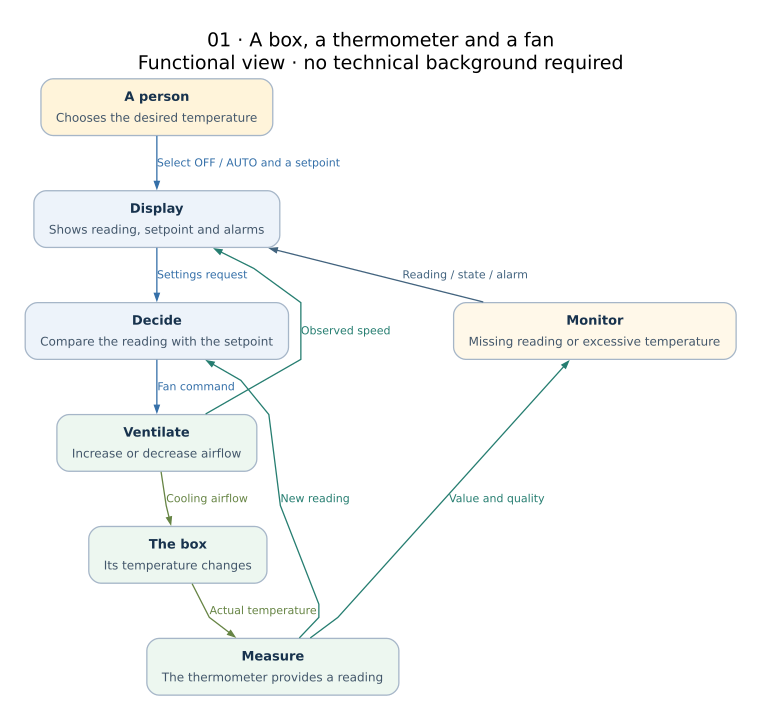

# SameLoop Lab

**Bind & Seek — Same Control Loop, Different Embedded Stacks.**

[GitHub organization](https://github.com/sameloop-lab) · [Repository](https://github.com/sameloop-lab/sameloop-lab) · [Français](README.fr.md)

SameLoop Lab is an open test bench for comparing embedded service architectures
through one thermal-control application: a temperature sensor, a setpoint, a
controller and a fan. We compare integration, communication, failure handling
and delivery under explicit functional requirements. This is not a performance ranking.

**Edition 0.2.0 — 25 October 2026.** This repository contains documentation,
signal catalogs, diagrams and imported validation evidence. Implementation
packages are separate; their publication URLs and immutable revisions remain
to be registered. A runnable component does not imply a complete platform integration.

## Explore

Open **[index.html](index.html)** after downloading and extracting the archive.
The dashboard works offline, with project filters and a diagram gallery. No build
is required for reading. GitHub's file view shows HTML source; download it or
host the generated files as a static site. No hosted site is claimed here.



## Current evidence

| Component | Available evidence | Not established |
|---|---|---|
| Four AFB bindings | Build, model tests and 11 real-binder integration scenarios reported | Connected GUI, hardware, TLS, complete redpesk image |
| KUKSA Linux profile | 8 unit tests and 13 real-broker scenarios reported | Complete AGL image, GUI, TLS, automatic reconnect |
| Plant model | 6 unit tests, Python packaging reported | Numerical equivalence with older AFB/UI simulators |
| LVGL UI | Build and headless SDL/model tests reported | Interactive target validation or backend connection |
| Flutter UI | Sources and tests delivered | Build/test success not established by available evidence |
| OpenHarmony, webOS, Zephyr, CommonAPI | Architecture proposals | Implementations and platform qualification |

Reports are [imported from previous deliveries](results/README.md), not rerun by
this documentation build. The detailed [project index](docs/projects.md) is
generated from JSON, with a separate evidence link for each implemented component.

## The same functional contract

- Observe temperature, quality, freshness and fan feedback.
- Request OFF/AUTO and a finite setpoint between 15 and 40 °C.
- Start OFF at 25 °C; keep requested and applied values distinct.
- In AUTO, request `clamp(20 × (temperature − setpoint), 0, 100)` percent.
- Treat invalid or stale measurements as unavailable; do not display missing data as zero.
- Report overtemperature above 50 °C, independently of OFF/AUTO.

Read the [functional specification](docs/functional-spec.md). It describes the
target contract; [known deviations](docs/deviations.md) explain what the first
implementations do not yet provide. The simulation's failure policy is not a
safety design for physical cooling equipment.

## Browse by topic

| Topic | Entry point |
|---|---|
| redpesk / AFB | [Bindings and real-binder tests](redpesk/README.md) |
| AGL / KUKSA | [Linux prototype and AGL boundary](agl/README.md) |
| Physical simulation | [Independent plant model](plant/README.md) |
| OpenHarmony / webOS OSE | [OpenHarmony](openharmony/README.md), [webOS](webos/README.md) |
| Linux and microcontrollers | [Zephyr, zbus and physical links](zephyr/README.md) |
| Optional service architecture | [CommonAPI / SOME-IP](commonapi/README.md) |
| User interfaces | [Flutter, LVGL and Qt](ui/README.md) |
| Communications and security | [Layer boundaries and TLS modes](docs/communications.md) |
| Diagrams | [14 editable architectural views](docs/diagrams.md) |
| Tests and future mocks | [Testing strategy](tests/README.md) |
| Evidence and delivery | [Results](results/README.md), [delivery](delivery/README.md) |
| FOSDEM | [Presentation scope](presentations/README.md) |

## Build the documentation

Node.js 20+ and Python 3 are required only to regenerate or check the documents.

```bash
npm ci
npm run build
npm run check
```

`npm ci` installs the locked dependencies, including **markdown-it** and
**@viz-js/viz** (Graphviz in WebAssembly). Run it before the first build.
The build itself works without network access. Edit Markdown, JSON and DOT
sources; do not edit generated HTML, SVG or `docs/projects.md` by hand.
See [the documentation workflow](docs/build.md).

## Future testing extension

A proposed `sameloop-tests` would replay common failure scenarios against real
services. Toxiproxy is a candidate for TCP disruptions and MockServer for selected
service mocks. Neither is integrated in this release. See [the scoped plan](tests/README.md).

## Contribution and license

Original content uses the [MIT License](LICENSE); third-party software retains
its own license. See [CONTRIBUTING.md](CONTRIBUTING.md). This project supports
preparation of a FOSDEM proposal; no acceptance or vendor endorsement is claimed.
