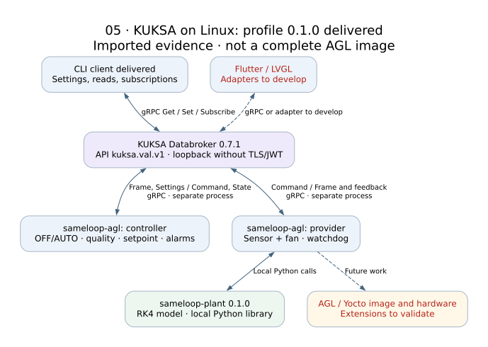

# AGL / KUKSA

`sameloop-agl` 0.1.0 is a **Python KUKSA-on-Linux prototype**, not an AGL image.
A provider and controller run as separate processes and communicate with
KUKSA Databroker 0.7.1 using `kuksa.val.v1`; the provider calls `sameloop-plant`
locally. A CLI offers commands, snapshots and a real streaming subscription.
The SDK dependency is kuksa-client 0.6.0. No transparent VAL v2 fallback is used.

[Imported validation](../results/imported/agl/VALIDATION.md): 8 unit tests and
13 real-broker scenarios. The independent plant adds 6 unit tests.
This profile runs on trusted loopback without TLS/JWT. On RPC failure, services
exit with an error; automatic reconnect is not implemented. Role semantics are
not enforced by the broker in this profile. No GUI has been connected yet.

The signal catalog and its mapping are in [model](../model/kuksa-mapping.md).
The separate implementation package contains installation/run instructions,
Python wheels and draft RPM specs. RPM/OBS and Podman were not validated.
An AGL/Yocto image requires its own pinned integration and test campaign.

Upstream: https://github.com/eclipse-kuksa/kuksa-databroker
