# Diagram gallery

Editable DOT sources and generated SVGs, adapted from sameloop-dev-project. All diagram labels are in English. Future project names are red; architecture dashed links indicate work to qualify. Functional arrows describe relationships, not test results.

## 01 · A box, a thermometer and a fan

Functional view · no technical background required

[Editable DOT](../assets/sources/01-fonctionnel.dot)

## 02 · Demo states

OFF/AUTO = user choice · availability and alarm are separate dimensions

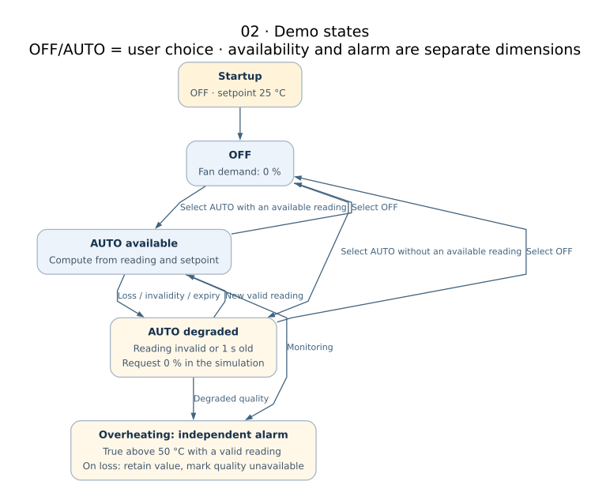

[Editable DOT](../assets/sources/02-etats.dot)

## 03 · Same function, different implementations

Target architecture · choose one stack · red names = future projects

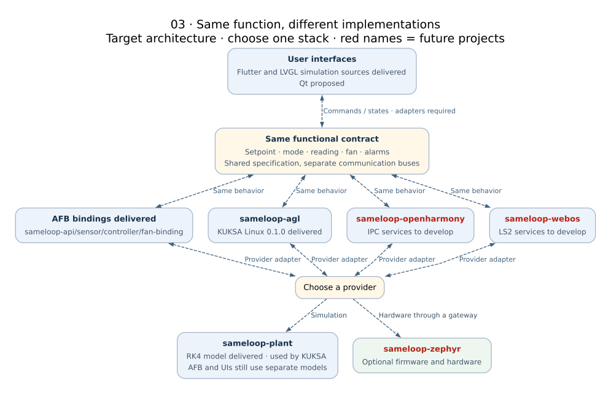

[Editable DOT](../assets/sources/03-panorama.dot)

## 04 · redpesk / AFB: four bindings delivered

Solid = reported lab integration · dashed = future connection

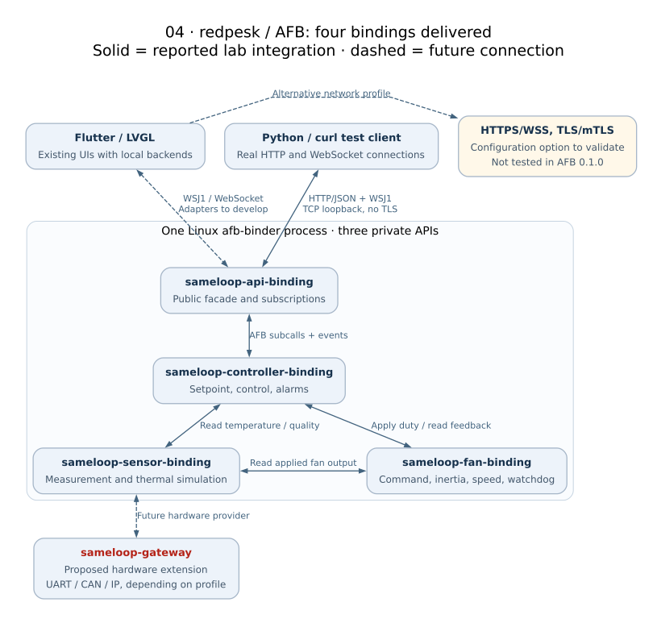

[Editable DOT](../assets/sources/04-afb.dot)

## 05 · KUKSA on Linux: profile 0.1.0 delivered

Imported evidence · not a complete AGL image

[Editable DOT](../assets/sources/05-agl.dot)

## 06 · OpenHarmony: IPC services and external UI

Proposed architecture · same device for the first prototype

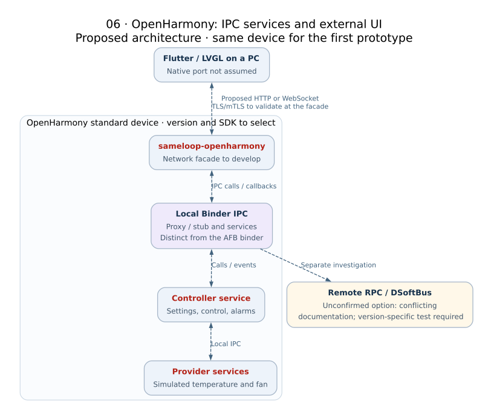

[Editable DOT](../assets/sources/06-openharmony.dot)

## 07 · webOS OSE: services on Luna Bus

Proposed architecture · OSE target; commercial TV support not assumed

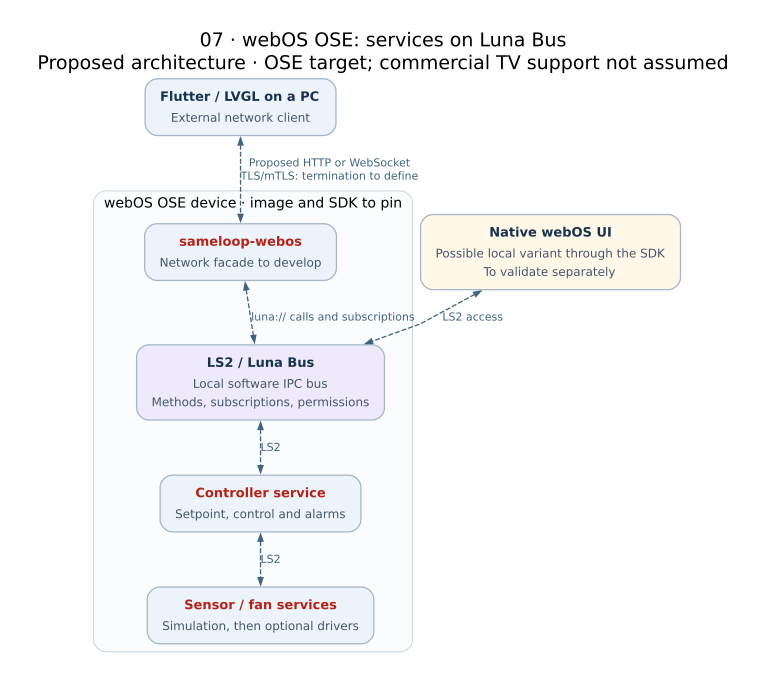

[Editable DOT](../assets/sources/07-webos.dot)

## 08 · Zephyr: software zbus and explicit external link

Shown variant: local MCU control · all connections remain to be developed

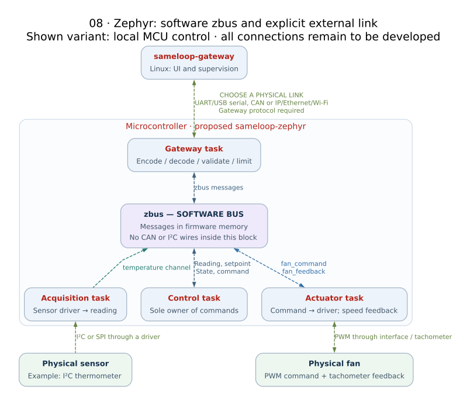

[Editable DOT](../assets/sources/08-zephyr.dot)

## 09 · From messages to wires: three alternative links

Conceptual diagram · pinout, transceivers, power and drivers require validation

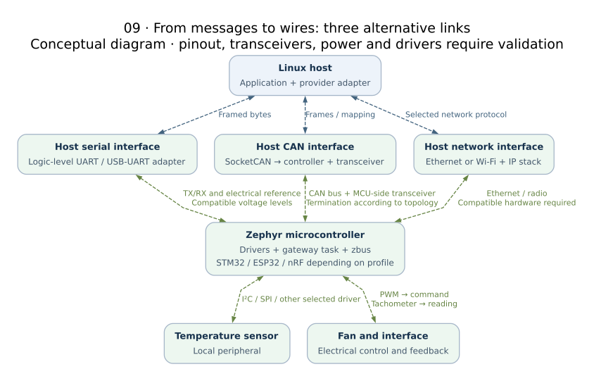

[Editable DOT](../assets/sources/09-materiel.dot)

## 10 · Plaintext, server-authenticated TLS and mTLS

Security concepts · no SameLoop TLS profile tested yet

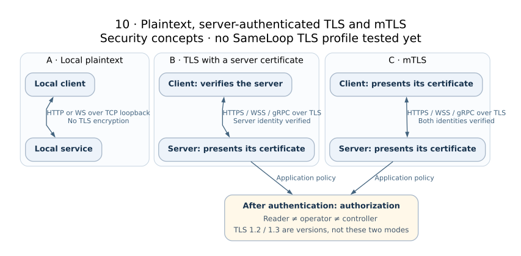

[Editable DOT](../assets/sources/10-tls.dot)

## 11 · CommonAPI / SOME/IP: comparison extension

Proposed architecture · optional stack beyond the MVP

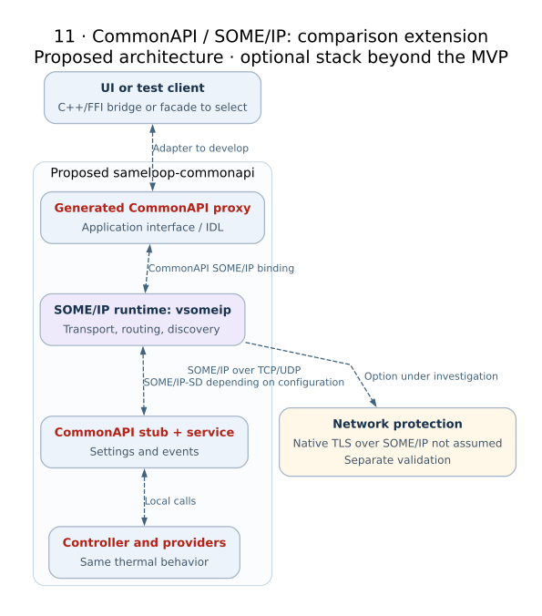

[Editable DOT](../assets/sources/11-commonapi.dot)

## 12 · Every test level has a scope

Passing unit tests does not validate the network, UI or hardware

[Editable DOT](../assets/sources/12-tests.dot)

## 13 · From repositories to reproducible demos

Proposed workflow · build systems remain specific to each target

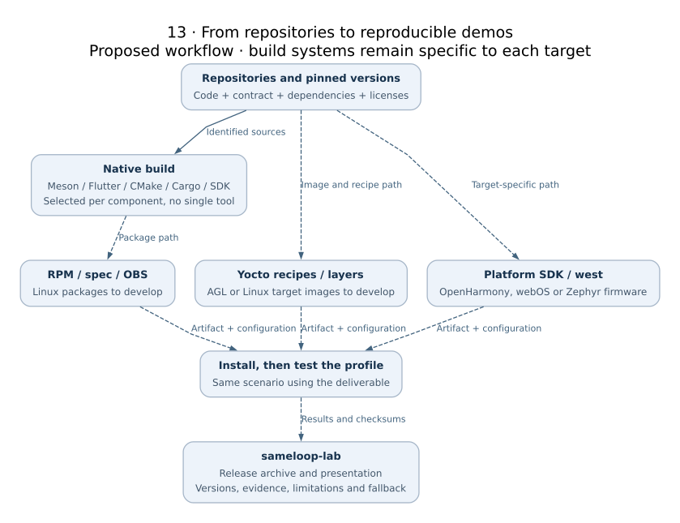

[Editable DOT](../assets/sources/13-livraison.dot)

## 14 · Connect two stacks with a single controller

Proposed first step: AFB → KUKSA telemetry only

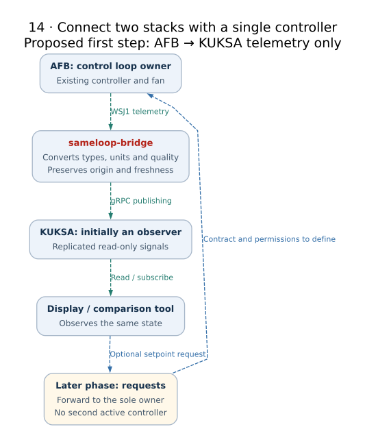

[Editable DOT](../assets/sources/14-interop.dot)
