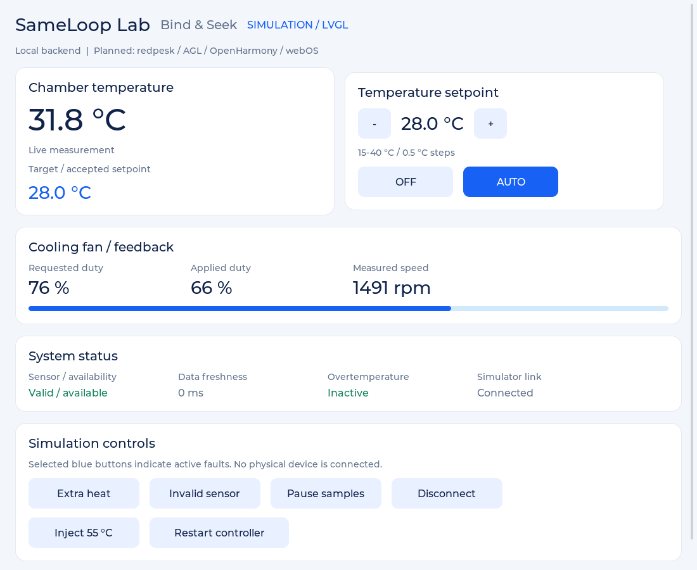

# E02 — LVGL 0.1.0

Origine : `VALIDATION.md` livré avec `sameloop-ui-lvgl`, daté du 24 octobre 2026.
Rapport de build Linux x86_64, GCC/G++ 13.3, LVGL 9.2.2 et SDL2 2.30.0.
Tests CTest du modèle et de l'UI en pilote SDL dummy rapportés réussis.
Une capture réellement produite par LVGL a été inspectée lors de cette livraison.

Limites : pas de session interactive Fedora, pas de validation souris/clavier
système, pas de carte/écran embarqué et aucun backend connecté. Les tests de widget
injectent des événements LVGL ; ce n'est pas un test du système de fenêtrage.
