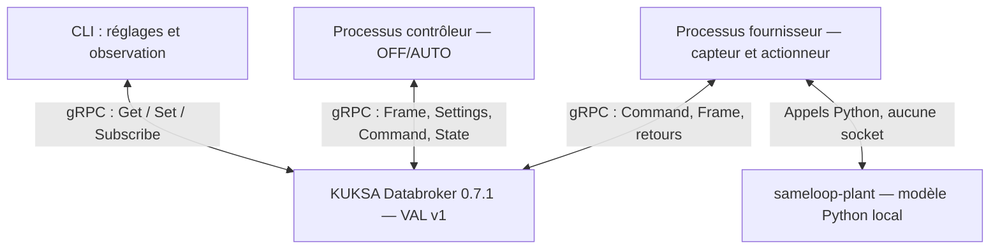

# Architecture livrée

Le broker est un véritable binaire amont ; aucun faux broker dans les tests
d'intégration. Fournisseur et contrôleur sont des processus séparés. La physique
capteur/fan est regroupée dans un fournisseur pour préserver un état cohérent.
Chaque service effectue une boucle de lecture/publication nominale à 10 Hz.
La commande `watch` montre séparément un abonnement gRPC serveur vers client.

Le chemin AFB n'est pas utilisé dans cette implémentation. Aucune traduction
AFB ↔ KUKSA ni adaptation Flutter/LVGL n'est incluse. Le modèle Python pourrait
être réutilisé dans un fournisseur AFB ou derrière une passerelle ; cela reste
un développement distinct. Zephyr, zbus, UART et CAN ne sont pas simulés en tant
que transports : ils ne sont pas présents dans cette version.

## Prochaines étapes

1. Rejouer les tests sur Fedora et relier une UI à VAL v1.
2. Décider si garder les enveloppes JSON ou passer à un contrat plus typé.
3. Ajouter autorisations et TLS avant une ouverture réseau.
4. Figer l'image AGL et ses versions KUKSA/Python avant recette Yocto.
5. Remplacer le fournisseur simulé par un fournisseur matériel qualifié.

L'API VAL v2 impose de revoir le chemin d'actuation ; changer simplement le nom
d'import Python ne constitue pas un portage.
