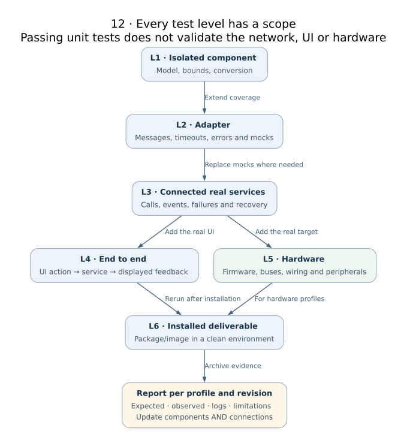

# Testing and optional open-source mocks

Current evidence uses real AFB/KUKSA services. A future `sameloop-tests` may share
functional scenarios across stacks. It is **planned, not integrated** in 0.2.0.

| Purpose | Candidate | Boundary |
|---|---|---|
| Physical simulation | sameloop-plant | Models temperature and fan dynamics; already used by KUKSA |
| Network disruption | [Toxiproxy](https://github.com/Shopify/toxiproxy) | TCP faults around real services; planned |
| Selected service mocks | [MockServer](https://www.mock-server.com/) | Qualify a pinned release against KUKSA Get/Set/Subscribe; planned |
| Cross-stack orchestration | Python runner, JUnit reports | Proposed sameloop-tests; no common runner delivered |

MockServer documents gRPC mocking, including server-streaming. This does not
mean it automatically implements KUKSA state, actuation, metadata or the AFB
WSJ1 protocol. See [its gRPC documentation](https://www.mock-server.com/mock_server/grpc_mocking.html).
Toxiproxy operates on TCP connections; it does not perturb local AFB subcalls,
zbus memory channels or a physical CAN bus.

Start with real-stack tests and common scenarios: frozen sensor, delayed command,
controller loss, broker restart and invalid values. Add mocks only where a
specific dependency behavior is otherwise difficult to reproduce. Keep expected
results version-specific: the current KUKSA profile does not auto-reconnect.

Code coverage requires instrumenting the tested code. A mock server alone does
not produce C/Rust/Python coverage. No framework integration, coverage percentage
or benchmark result is claimed by this roadmap.
